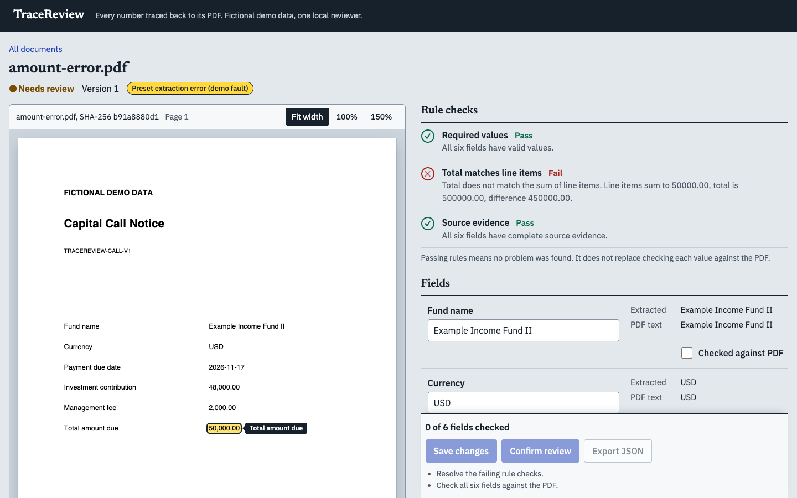
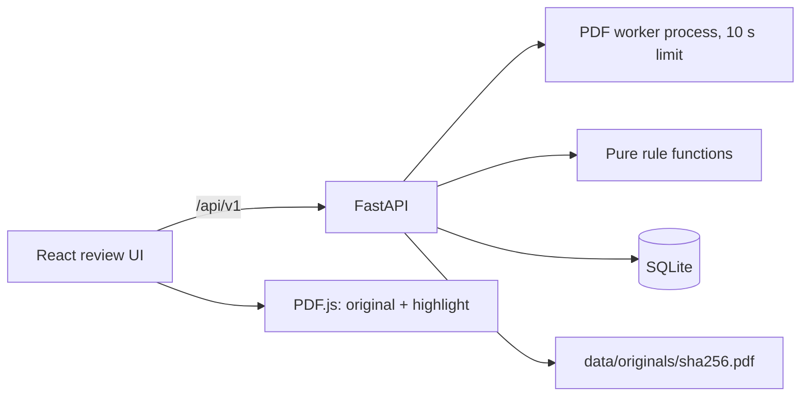

# TraceReview

Review a fund's capital call notice against its PDF. TraceReview turns one fixed notice
template into six structured fields, shows each value's source in the real PDF, runs three
deterministic rule checks, and lets a person correct, check and confirm the record before a
JSON export. Every edit is kept in a history; nothing is overwritten.

It is a **portfolio project for a narrow case**, not a general PDF extractor. The data is
fictional and runs on one machine for one local reviewer.



## What it does

1. **Upload** a PDF (or import one of four bundled samples).
2. **Extract** six fields by their printed labels: fund name, currency, payment due date,
   investment contribution, management fee, total amount due. Each keeps its source text and
   its position on the page.
3. **Check** three rules: required values, *total = investment + fee* (exact cents), and
   source evidence present.
4. **Locate**: selecting a field frames its value in the rendered PDF.
5. **Correct and check**: edit values (with a reason), tick "Checked against PDF" per field.
6. **Confirm** the whole record, then **export** the confirmed version as JSON.

Passing rules means "no problem found". It is never treated as a human check: the rules can
pass while all three amounts are ten times too large, so confirmation always needs the six
explicit checks.

## Supported documents

* One template, `capital_call_v1`: English, single page, A4-style, with a text layer,
  marker `TRACEREVIEW-CALL-V1`, six labelled rows, **USD only**, up to 5 MiB.
* Not supported: scans/OCR, rotated or cropped pages, multi-page files, other templates or
  currencies, encrypted files. These are rejected with a specific error and leave no record.

## Fault injection (read this)

Three of the four samples demonstrate the review flow with an **injected extraction fault**.
The extractor itself is a deterministic template parser; it does not make these mistakes.

| Sample | PDF says | Injected candidate | Why |
|---|---|---|---|
| Normal notice | all correct | none | baseline |
| Preset total error | total 50,000.00 | total 500,000.00 | shows the total rule failing and a correction |
| Preset missing due date | due date present | due date empty | shows filling a value from the PDF |
| Missing source value | due-date label, blank value | none (nothing to extract) | shows a record that cannot be confirmed |

Faults are keyed to the SHA-256 of the bundled files in `fixtures/manifest.json`; uploads can
never request one, and the UI labels them "Preset extraction error (demo fault)".

## Requirements

* Python 3.12 (developed on 3.12.1) and Node.js 22.12 or newer (developed on 24).
* A modern Chrome for the browser tests (or install Playwright's Chromium, see below).

## Install

```bash
python3.12 -m venv .venv
.venv/bin/python -m pip install -r backend/requirements.txt
```

```bash
cd frontend && npm ci
```

## Run

Two terminals. The backend binds to `127.0.0.1` only and runs a single worker.

```bash
cd backend && ../.venv/bin/python -m app
```

```bash
cd frontend && npm run dev
```

Open <http://localhost:5173>. Data is written under `./data` (git-ignored); set
`TRACEREVIEW_DATA_DIR` to use another folder. Samples are copied from `fixtures/` into the
frontend automatically (`npm run sync-samples`). To regenerate them byte for byte:
`.venv/bin/python scripts/generate_fixtures.py`.

A 90-second path: import **Preset total error**, click *Total amount due* to see the box on
the printed value, read why the total rule fails, correct to `50,000`, enter a reason, save,
tick the six checks, confirm, export, then edit a field and watch the confirmation withdraw.

## Verify

```bash
cd backend && ../.venv/bin/python -m pytest
```

```bash
cd frontend && npm run test -- --run && npm run build
```

```bash
cd frontend && npx playwright test
```

The browser tests start the backend (on a fresh temporary data folder) and the dev server
themselves, drive a real Chrome, and measure ink in the rendered PDF canvas under the
highlight box at fit width, 100% and 150%, at 1440 px and 390 px, with a device pixel ratio
of 2. To use Playwright's bundled browser: `npx playwright install chromium`, then
`PW_CHANNEL= npx playwright test`.

`docs/acceptance.md` maps each acceptance item (A01 to A20) to the tests that check it.

## How it works



* **Money** is a decimal string end to end (`"50000.00"`); arithmetic uses integer cents.
  No floats, no rounding to make a sum fit.
* **Three layers per field**: source (text, value, position; never edited), initial
  extraction (never edited), current value (changes only through the save endpoint).
* **Versions**: every write names the version it saw (`expected_version`). A stale write is a
  409 and the page keeps your draft; it never silently overwrites. Each real change bumps the
  version once and appends its history event in the same transaction.
* **Server-side gates**: confirmation and export re-check version, rules, the six checks and
  the stored original's hash on the server. The disabled buttons are only hints.
* **Export** reads one consistent snapshot of the confirmed version, builds the bytes, then
  records an `EXPORT_GENERATED` event. A concurrent edit yields either the complete older
  confirmed file or a version conflict, never a mixture.
* **Parsing** runs in a separate process with a timeout; uploads are hashed, de-duplicated and
  stored under their hash, never under the upload name.

```
backend/app/    FastAPI app, domain rules, PDF parser, services
backend/tests/  pytest suite
frontend/src/   React + TypeScript + Vite
frontend/e2e/   Playwright
fixtures/       fictional PDFs, manifest, hand-written expected values
scripts/        fixture generator
docs/           acceptance map, case study
```

## Limits

Local, single user, single worker: the reviewer name `local-reviewer` is a label, not an
authenticated identity. The history is an application log, not tamper-proof storage. There is
no login, rate limiting or cleanup, so do not expose the backend to a network. No external
model or network service is used. This is a demonstration of a review workflow, not a
compliance product, and says nothing about accuracy on real documents.
